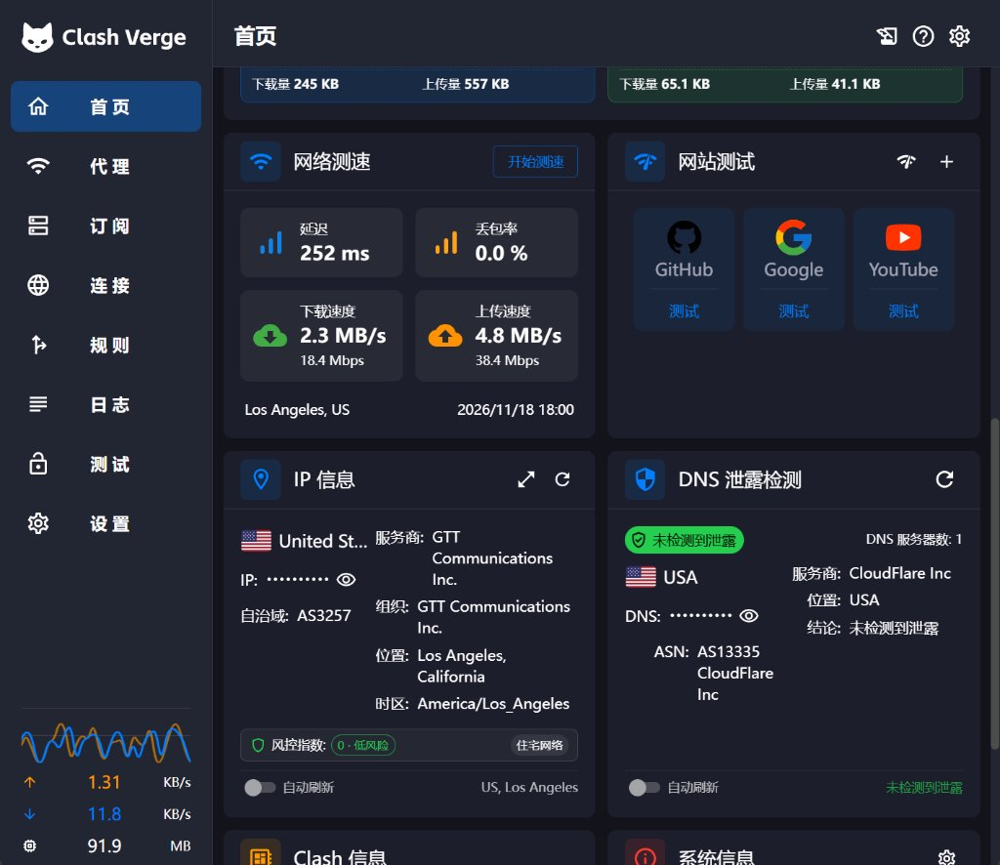
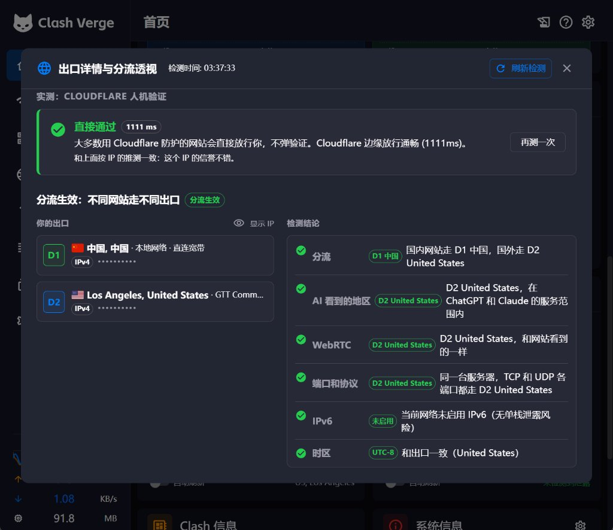

# Clash Verge Rev (SpeedTest & Enhanced)

语言：简体中文 | [English](./docs/README_en.md)

本项目 Fork 自官方开源仓库 [clash-verge-rev/clash-verge-rev](https://github.com/clash-verge-rev/clash-verge-rev)（`dev` 分支），在原版基础上针对网络测速、流量统计、IP/DNS 检测、现代代理协议解析以及系统安全性进行了深度增强与全面审计修复。

  

  

---

## 本项目修改内容

### 1. 当前代理节点网络测速
- 首页新增独立网络测速卡片，测速流量严格通过当前生效的代理端口隧道发出。
- 支持四项核心指标测定：延迟（Ping 中位 RTT）、丢包率（%）、流式下载速度、上传速度。
- 自动解析并展示测速节点的出口所在地地区与测速时间戳，测速数据本地持久化保存。
- 首页设置支持自由开启或关闭测速卡片。

### 2. 分类流量统计与后台常驻监听
- 首页流量卡片重构为「代理流量」与「直连流量」双轨分类统计，独立统计实时速率与累计用量。
- 重构数据采集架构，客户端最小化或退入系统托盘时后台持续保持流量采样，彻底解决原版后台不统计流量的问题。

### 3. IP 信息与风控评估优化
- 首页 IP 信息卡片默认采用**手动触发检测**（保留可选自动刷新开关），避免在未开启时后台自动发起第三方风控请求。
- 卡片右下角去除经纬度，改为显示国家代码与城市（如 `US, Los Angeles`）。
- 新增 IP 综合风控分、风险等级（低/中/高风险）及网络类型（住宅/数据中心/商业/移动网络）展示。
- 参考多源交叉评估机制，并发查询 IPinfo、ipapi、ipquery、proxycheck.io 与 Scamalytics 数据源，精准区分住宅宽带与数据中心 IP 并融合原生连续风控评分。
- 重构 IP 检测服务数据映射，全面兼容各类服务商的嵌套与扁平数据结构，解决部分服务商全显 Unknown 的问题。

### 4. IP 出口详情与分流透视
- 点击 IP 卡片展开按钮呼出大尺寸弹窗，采用手动刷新检测机制，避免多余背景网络开销。
- 实测 Cloudflare 人机验证：检测当前出口在 Cloudflare 防护下的通行信誉（直接放行/人机验证/阻断），支持一键再测。
- 分流透视（双栏结构）：
  - 左栏列出各出口（国家/地区、运营商、ASN、IPv4/IPv6，支持 IP 脱敏显示）；
  - 右栏输出多维检测结论，正常项标绿，异常/泄露项标红；
  - 兼容全局与分流模式识别，并在本地系统时区与出口时区比对、WebRTC 公网候选探测中精准排除误报；
  - 去除无实际意义的 NAT 类型检测。

### 5. DNS 泄露检测与默认海外 DNS 基线
- 首页新增 DNS 泄露检测卡片，默认采用**手动触发探测**（可选开启自动刷新），展示当前生效的 DNS 服务器、国家、服务商与 ASN。
- 检测请求由后端直接通过代理隧道发起，零端口状态下拒绝直连物理网卡发送探测。
- 优化泄露判定算法，仅在境外代理出口出现境内/局域网私有 DNS 时报警，正常境外远程 DNS 判定为安全，杜绝误报。
- 统一前后端默认 DNS 配置为海外公共解析器（`1.1.1.1`、`8.8.8.8`、`https://1.1.1.1/dns-query`、`https://dns.google/dns-query`），并自动剔除各解析列表中的残余 `system` 与 `dhcp://` 项。
- TUN 模式默认启用 `strict-route`（严格路由）与全协议端口劫持（`any:53`、`tcp://any:53`），阻断 Windows 多宿主解析（SMHNR）向物理网卡泄露。

### 6. 代理协议全链路解析增强（v2.6.2）
- 完整支持 **VLESS XHTTP**（含 `splithttp` 别名、流控与填充参数、XMUX 复用配置与上下行分离配置）、后量子加密参数及 `ech-opts` 解析，并修复标准 VLESS WebSocket 被误标为 HTTP Upgrade 的问题。
- 补全 Trojan、Shadowsocks（`shadow-tls`、`restls` 等插件）、VMess、Hysteria2（多端口与跳跃间隔）、TUIC（v4 Token 与流式 UDP）、WireGuard（AmneziaWG）及 AnyTLS 等主流协议的 URI 解析与类型校验。
- 新增 `mieru://`、`sudoku://` 与 `ssh://` 代理分享链接导入解析。
- 节点列表精确展示 `XHTTP` 与 `XMUX` 标签，并按核心配置与独立订阅来源隔离作用域避免同名覆盖。

### 7. 稳定性与安全性全面加固
- WebDAV 同步默认开启严格 TLS 证书验证并拦截跨域/降级重定向携带凭据；磁盘凭据采用 AES-256-GCM 加密保存，前端缓存仅保留 SHA-256 摘要。
- 备份恢复强制实施条目白名单、大小与数量上限校验，并自动清除高危启动脚本与主题注入字段；订阅配置写入采用原子临时文件安全替换。
- 收紧 WebView CSP 与文件系统作用域，修复主题 CSS 注入点并限制 `.js` 脚本以系统默认关联方式直接执行；Windows 外链唤起协议写入双引号转义并新增导入确认弹窗，本地与 UNC/设备路径在扫描与打包阶段均受严格隔离校验。

---

## 相关文档与下载

- 更新日志：[Changelog.md](./Changelog.md)
- 隐私说明：[PRIVACY.md](./PRIVACY.md)
- 构建产物获取：👉 **[Releases 页面](https://github.com/XYZ-ZJ/clash-verge-rev-speedtest/releases)**

| 平台架构 | 安装包文件名 | 说明 |
| :--- | :--- | :--- |
| **Windows x64** | `Clash Verge_2.6.2_x64-setup.exe` | 适用于 64 位 Windows 系统的标准 NSIS 安装程序 |

---

## 开源协议

本项目基于 [GPL-3.0 License](./LICENSE) 开源。
