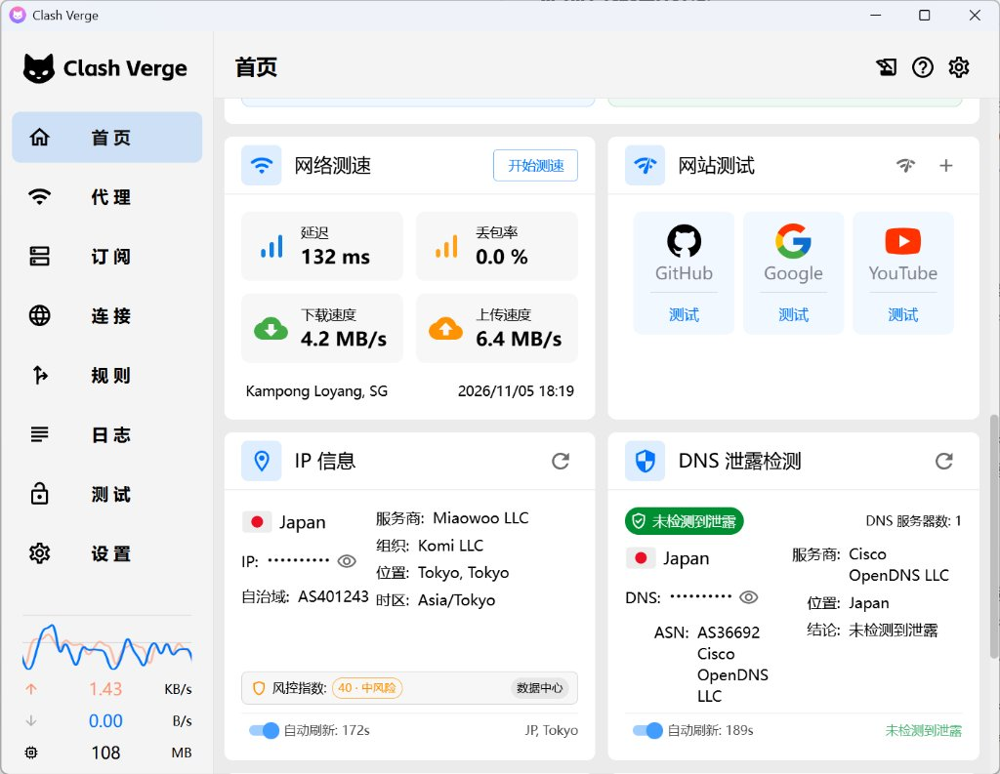

# Clash Verge Rev (SpeedTest & Enhanced)

本项目 Fork 自官方开源仓库 [clash-verge-rev/clash-verge-rev](https://github.com/clash-verge-rev/clash-verge-rev) (`dev` 分支)，在原版基础上针对网络测速、流量统计、IP/DNS 检测与系统路由安全性进行了增强与修复。

  

---

## 本项目修改内容

### 1. 当前代理节点网络测速
- 首页新增独立网络测速卡片，测速流量严格通过当前生效的代理端口隧道发出。
- 支持四项核心指标测定：延迟（Ping 平均 RTT）、丢包率（%）、流式下载速度、上传速度。
- 自动解析并展示测速节点的出口所在地地区与测速时间戳，测速数据本地持久化保存。
- 首页设置支持自由开启或关闭测速卡片。

### 2. 分类流量统计与后台常驻监听
- 首页流量卡片重构为「代理流量」与「直连流量」双轨分类统计，独立统计实时速率与累计用量。
- 重构数据采集架构，客户端最小化或退入系统托盘时后台持续保持流量采样，彻底解决原版后台不统计流量的问题。

### 3. IP 信息与风控评估优化
- 卡片右下角去除经纬度，改为显示国家代码与城市（如 `JP, Tokyo`）。
- 新增 IP 综合风控分、风险等级（低/中/高风险）及网络类型（数据中心/住宅/商业/移动网络）展示。
- 重构 IP 检测服务数据映射，全面兼容各类服务商的嵌套与扁平数据结构，解决部分服务商全显 Unknown 的问题。

### 4. IP 出口详情与分流透视
- 点击 IP 卡片展开按钮呼出大尺寸弹窗，采用手动刷新检测机制，避免多余背景网络开销。
- 实测 Cloudflare 人机验证：检测当前出口在 Cloudflare 防护下的通行信誉（直接放行/人机验证/阻断），支持一键再测。
- 分流透视（双栏结构）：
  - 左栏列出各出口（国家/地区、运营商、ASN、IPv4/IPv6，支持 IP 脱敏显示）；
  - 右栏输出多维检测结论，正常项标绿，异常/泄露项标红；
  - 增加本地系统时区与出口时区一致性比对；
  - WebRTC 泄露时提示开启 TUN 模式与配置 `udp: true` 代理 UDP 流量以解决；
  - 去除无实际意义的 NAT 类型检测。

### 5. DNS 泄露检测与防护机制
- 首页新增 DNS 泄露检测卡片，展示当前生效的 DNS 服务器、国家、服务商与 ASN。
- 检测请求由后端直接通过代理隧道发起，本地操作系统与物理网卡不参与解析。
- 优化泄露判定算法，仅在境外代理出口出现境内/局域网私有 DNS 时报警，正常境外远程 DNS 判定为安全，杜绝误报。
- 自动过滤并剔除配置中默认残留的 `system` DNS，避免内核向系统/路由器 DNS 发送查询。
- TUN 模式默认启用 `strict-route`（严格路由）与全协议端口劫持（`any:53`、`tcp://any:53`），阻断 Windows 多宿主解析（SMHNR）向物理网卡泄露。

### 6. 稳定性与安全性改进
- 订阅配置文件保存采用原子临时文件安全替换，防止异常断电或退出导致配置文件截断损坏。
- WebDAV 与本地备份接口增加路径合法性校验，防范路径穿越。
- 修复部分连接句柄泄漏与高频无效渲染问题。

---

## 下载安装

最新编译产物请前往 Releases 页面获取：

👉 **[下载最新安装包 (Releases)](https://github.com/XYZ-ZJ/clash-verge-rev-speedtest/releases)**

| 平台架构 | 安装包文件名 | 说明 |
| :--- | :--- | :--- |
| **Windows x64** | `Clash.Verge_2.6.0_x64-setup.exe` | 适用于 64 位 Windows 系统的标准安装程序 |

---

## 开源协议

本项目基于 [GPL-3.0 License](./LICENSE) 开源。
