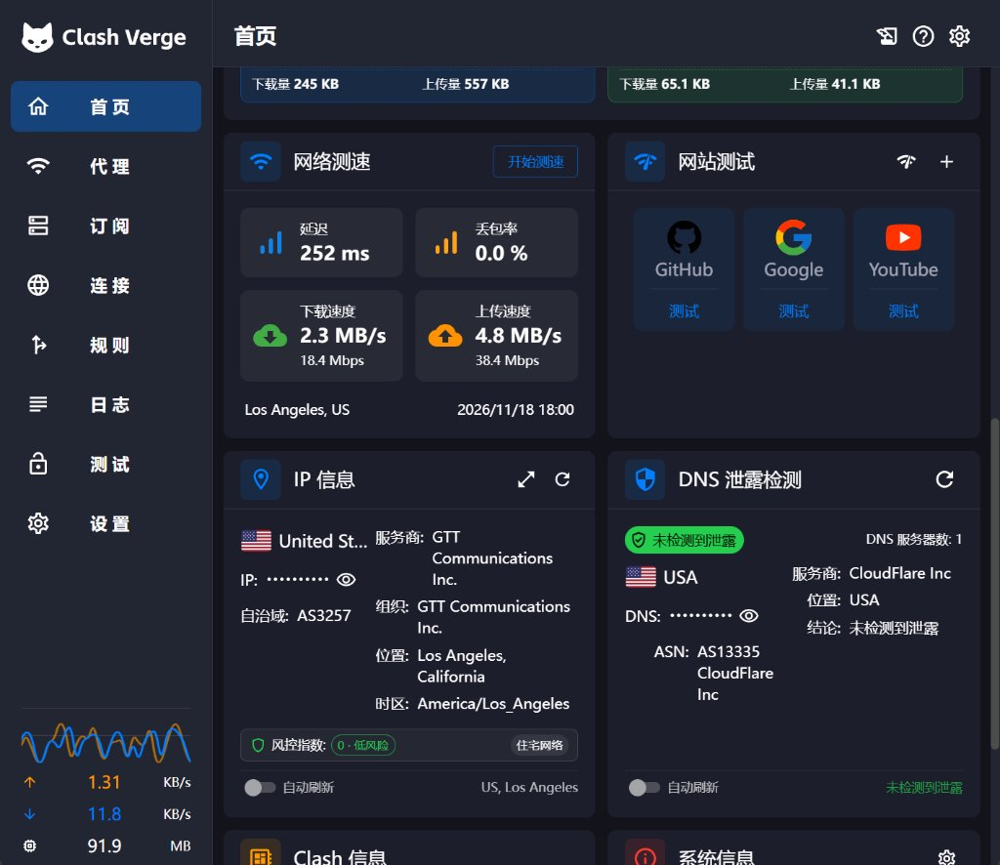
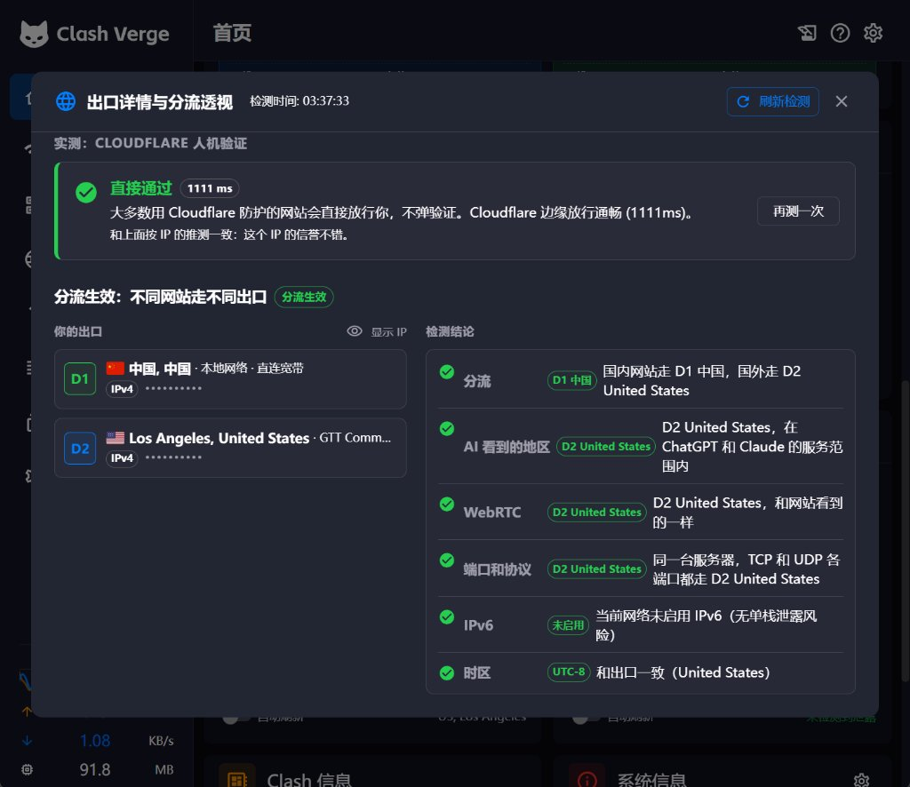

# Clash Verge Rev (SpeedTest & Enhanced)

Language: [简体中文](../README.md) | English

> Forked from the upstream official repository: [clash-verge-rev/clash-verge-rev](https://github.com/clash-verge-rev/clash-verge-rev) (branch: `dev`), enhanced with integrated proxy speed testing, dual-track traffic statistics, multi-source IP/DNS leak & egress diagnostics, modern proxy protocol parsing, and full-codebase security hardening.

  

  

---

## Enhanced Features in This Fork

### 1. Active Proxy Network Speedtest
- Integrated directly on the main dashboard; speed test traffic is strictly routed through the active proxy Mixed Port tunnel.
- Measures **4 key metrics**: Ping latency (median RTT), packet loss rate (%), streaming download speed, and upload speed.
- Automatically identifies and caches the outbound node location and timestamp; visibility can be toggled in Home Settings.

### 2. Split Traffic Stats & Continuous Background Tracking
- Refactored into two independent cards — **Proxy Traffic** and **Direct Traffic** — tracking live speeds and cumulative volumes separately.
- Decouples WebSocket collection from page rendering so traffic curves and totals remain continuous even when minimized to the system tray.

### 3. Multi-Source IP Risk Evaluation (Manual by Default)
- Both the Home **IP Info card** and **DNS Leak card** default to **manual trigger** (with an opt-in auto-refresh toggle), avoiding unsolicited background queries on startup.
- Displays country code, city, fraud/risk score, risk level (`low` / `medium` / `high`), and IP type (`residential` / `datacenter` / `business` / `mobile`) cross-checked across IPinfo, ipapi, ipquery, proxycheck.io, and Scamalytics.

### 4. IP Egress & Split-Routing Inspector
- Expand the IP Info card to launch an on-demand diagnostic modal:
  - **Left column**: Direct and proxy IPv4/IPv6 exits (country/city, ISP, ASN, with IP masking toggle) plus a **Multi-Source IP Purity Score** panel (concurrently querying Scamalytics, ipquery, proxycheck.io, and ipapi on a 0–100 trust scale with gradient bars, tier badges, and manual refresh).
  - **Right column**: Structured split-routing findings, accurate system vs. exit timezone offset comparison, WebRTC public `srflx` leak detection, and live **Cloudflare Turnstile / edge trust probing** with one-click retest.

### 5. DNS Leak Guard & Unified Overseas Default DNS
- Performs DNS leak probes from the Rust backend through the proxy port (refusing direct physical-NIC fallback when the proxy port is unavailable).
- Uses unified overseas public resolvers by default (`1.1.1.1`, `8.8.8.8`, `https://1.1.1.1/dns-query`, `https://dns.google/dns-query`) across initialization and UI defaults, stripping stray `system` and `dhcp://` entries.
- Enables `strict-route` and full-protocol port 53 interception by default in TUN mode to prevent Windows multi-homed resolution leaks.

### 6. Extended Proxy Protocol Support (v2.6.2)
- Full **VLESS XHTTP** (`splithttp` alias, padding/stream controls, XMUX reuse settings, separated download settings), post-quantum encryption parameters, and `ech-opts` URI parsing, plus fix for standard `ws` misdetection.
- Extended URI parser coverage for Trojan, Shadowsocks (`shadow-tls`, `restls`, `v2ray-plugin`), VMess, Hysteria2, TUIC v4/v5, WireGuard (AmneziaWG), and AnyTLS, plus new imports for `mieru://`, `sudoku://`, and `ssh://`.
- Scoped node feature tagging (`XHTTP` / `XMUX`) isolated per provider to prevent name collisions.

### 7. Security & Stability Hardening
- Strict WebDAV TLS verification (blocking cross-origin/scheme-downgrade redirects with credentials), AES-256-GCM disk encryption for saved credentials, and SHA-256 summaries for local cache keys.
- Backup restore allowlist + archive size/count limits, staged validation with automatic rollback on failure, automatic stripping of `startup_script` / `css_injection` / untrusted core fields, and atomic profile file writes.
- SSRF-hardened icon fetching and direct delay probing (DNS-pinned resolution, hop-by-hop redirect validation, and SVG script/event sanitization), plus mandatory SHA-256 release digest/checksum verification and automatic rollback on core upgrades.
- Explicit WebView CSP, narrowed filesystem scope, thread-isolated JS script sandbox with recursion/stack bounds, circular `dialer-proxy` chain detection, route-scoped error boundary reset, quoted Windows Deep-Link registry entries with interactive confirmation dialog, and UNC/device-path guards in provider/runtime bundle collection.

---

## Documentation & Downloads

- Changelog: [Changelog.md](../Changelog.md)
- Privacy Policy: [PRIVACY.md](../PRIVACY.md)
- Releases: 👉 **[Download Latest Release](https://github.com/XYZ-ZJ/clash-verge-rev-speedtest/releases)**

| Architecture | Package | Description |
| :--- | :--- | :--- |
| **Windows x64** | `Clash Verge_2.6.3_x64-setup.exe` | Standard 64-bit Windows NSIS installer |

---

## License

This project is licensed under the [GPL-3.0 License](../LICENSE).
